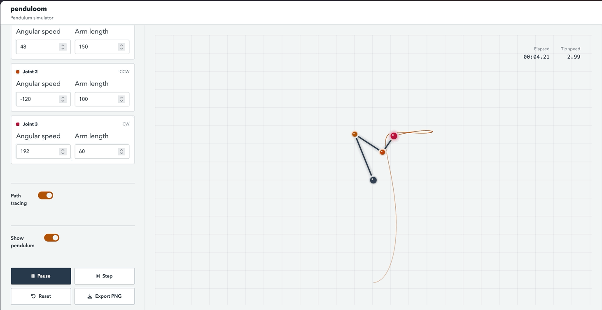
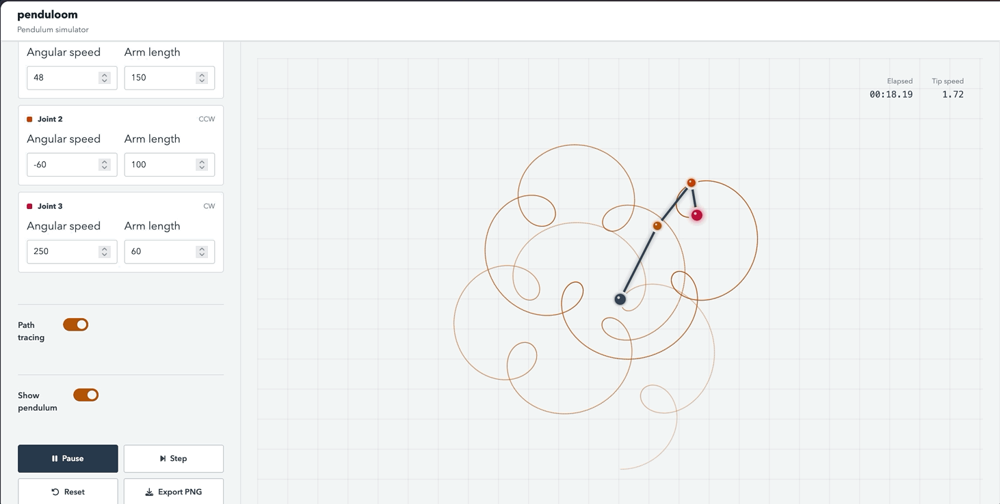

# penduloom
***Dislaimer:** All code in this package is AI written. All prose is human written*

`penduloom` is an R package containing a Shiny app for kinematic compound-pendulum experiments. Changeable options are number of joints, arm length, and angular speed. By default the tip of the pendulum will draw its path persistently so you can try to create some pretty pictures. 



## Install and run

```r
remotes::install_github("condwanaland/penduloom")
library(penduloom)
```

Then run the app with

```r
run_penduloom()
```

The code for calculating the simulation is all implemented inside R. Because implementing it in R would require a round trip to the backend for every single frame, plus the (slow) R code, `penduloom` calculates 10 seconds of the simulation at a time and sends it to the browser in a batch. The browser just interpolates and draws those frames. While it is running, another batch is calculated and sent, so it will continuosuly keep drawing smoothly. 


